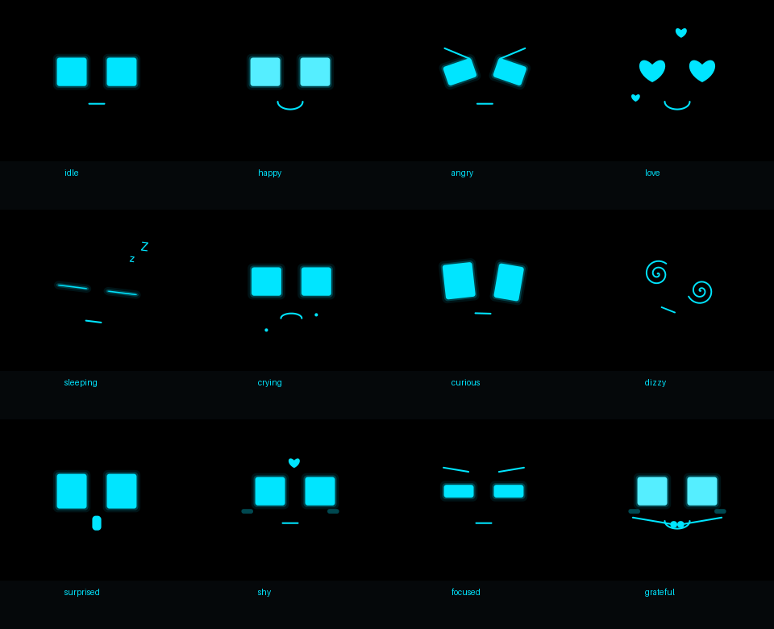

# DeskBuddy for Kodular

A separate `com.fabiyon.deskbuddy.DeskBuddy` extension. It adds a native animated avatar to an empty arrangement: black background, glowing cyan square eyes, expression-specific eye shapes, mouth, small gesture limbs and props. No API key, Gemini extension, WebView, downloaded artwork, microphone, or audio engine is required.

- [Download DeskBuddy.aix](https://github.com/shafrchdd/gemini-live-new/raw/refs/heads/main/dist/com.fabiyon.deskbuddy.aix)
- [Download DeskBuddyDemo.aia](https://github.com/shafrchdd/gemini-live-new/raw/refs/heads/main/examples/DeskBuddyDemo.aia) — includes the extension and all test blocks
- [Source/build bundle](https://github.com/shafrchdd/gemini-live-new/raw/refs/heads/main/dist/DeskBuddy-v2.zip)
- [Complete named catalogs](DeskBuddy-catalog.json)
- [Drawing gallery](../examples/deskbuddy/gallery/index.html) — download/open locally to filter sample poses



The preview uses a vector Canvas test double. Actual Android rendering, fonts, gestures, accelerometer behavior, and frame performance still need device testing.

## Import and test

Import the `.aia` into Kodular Creator, run Companion, then export a fresh APK. No separate extension import is needed for the demo. Its pickers list every named emotion, reaction, idle behavior, system overlay and conversation reaction. Touch, hold or drag the face; move the phone to test lift/shake. Enable/disable autonomous behaviors and sensors independently. For charging tests, disable real device monitoring, enter a battery percentage, select the simulated charger checkbox, and tap **Apply simulated power**. Re-enable monitoring to return to real battery/Wi-Fi information.

For your own project, import the `.aix`. Add an empty VerticalArrangement with a fixed height such as 340 pixels and width Fill Parent. From Screen.Initialize call `DeskBuddy.Attach(the arrangement component)`. The extension removes only its own view on detach/re-attach; do not use an arrangement that also contains your app's controls.

## Three independent layers

| Layer | Blocks | Lifetime |
| --- | --- | --- |
| Base emotion | `SetEmotion("sad")` | Persists until changed |
| Temporary reaction | `PlayReaction("wave", 2500)` | Returns to the base after 250–10000 ms |
| System overlay | `SetSystemOverlay("charging", true)` | Remains until its source clears it |

A sad face can wave while its charger bolt stays attached. `Sleep()` sets a persistent sleeping base; `WakeUp()` restores its previous awake emotion and plays waking-up motion. `StopReaction()` clears only the temporary layer. Manual overlays and automatic device overlays retain separate ownership: clearing one source does not erase the other. Disable DeviceMonitoring to use purely manual/simulated power overlays.

## Catalogs

There are 26 base emotions (including persistent sleeping), 28 interactive reactions, 21 device/system names, 20 conversation cues and 27 idle/gesture behavior names. The getter blocks `Emotions`, `Reactions`, `SystemStates`, `ConversationReactions` and `IdleBehaviors` return Kodular lists. Use the lowercase underscore names in the JSON catalog; spaces/hyphens are normalized. `focus`, `shake`, `wifi_off`, `mic_on` and `mic_muted` have aliases.

Animations are parametric vector poses. Examples include square-eye breathing/blinking; bright smiling happy eyes; heart/spiral eyes; tears and blush; tilt, jump, spin, bounce and wobble; waving/clapping/hugging arms; a book, controller, coffee cup, ball, butterfly and thought bubbles. Some related cues share gesture families. The compact screen avatar represents gestures rather than reproducing a physical robot's body. Whistling/humming use visual music cues and do not play sound.

## Touch, lift and shake

`Touched(x,y)` uses local pixel coordinates. Touch moves the eye gaze; tapping giggles, holding for about 650 ms hugs, and dragging swings/wobbles. Drag events are limited to roughly ten per second. Touch wakes sleeping mode and postpones automatic sleep. AutoReactions can be disabled while retaining touch events for your own blocks.

`Shaken(strength)` requires opposite high-acceleration peaks and a cooldown. ShakeThreshold defaults to 9.5 m/s² of filtered linear acceleration and can be set from 4–30. `Lifted()` is inferred from an upward acceleration impulse followed by settling; an accelerometer cannot measure actual height or reliably distinguish every pickup. Device mounting and motion affect results. `MotionSensorAvailable()` reports whether an accelerometer exists. The demo still works without one.

Sensors register only when attached, enabled and foregrounded. Stop, detach, screen backgrounding, destruction and deletion unregister sensor/device observers and remove animation/touch callbacks. Returning resumes paused reaction/idle timers; it does not keep animating while the screen is stopped. Invisible views skip drawing and use a slower frame callback. FramesPerSecond defaults to 30, clamped to 10–60. No global Android audio mode, brightness, Wi-Fi state or system power settings are changed.

KeepScreenOn is an opt-in view setting, off by default. Enable the demo checkbox when using the phone as a desk display so Android's screen timeout does not hide autonomous sleep/idle animations. Stop/backgrounding releases the avatar's request; it does not remove another component's request to keep the screen awake.

## Device overlays

Use the Designer properties or setter blocks `ShowBatteryIcon` and `ShowWifiIcon`: `false` hides that symbol and `true` shows it again. Both default to true and work independently, including manual overlays and temporary system previews. The demo includes two matching checkboxes. Monitoring, battery/Wi-Fi events and automatic reactions continue while icons are hidden. Hiding the battery icon also hides its draining arrow; the attached charging power bolt remains visible when plugged in.

Battery and plug state are read from Android's battery broadcast. A connected charger keeps the cyan power bolt attached to the avatar throughout other expressions. Charging pulses an energy ring; a transition to 100% celebrates with a green battery. Unplugged levels at 6–20% show low battery; 0–5% show a blinking critical warning. Declining battery contributes tired eyes and a draining indicator. `BatteryLevel()` returns -1 when unknown; `IsPluggedIn()` reports the displayed plug state.

Wi-Fi connectivity is read with the normal `ACCESS_NETWORK_STATE` permission. Its connected/disconnected overlays do not attempt to connect or modify the network. `ChargingChanged`, `BatteryLevelChanged`, `WifiChanged` and `SystemOverlayChanged` report changes.

`SetPowerState(level, plugged)` supplies simulated/external power data. Disable DeviceMonitoring before using it, as the demo does. Enabling real monitoring refreshes the OS snapshot. Other states such as connecting, listening, speaking, microphone muted, camera active, notification, update and AI error are set by your app through overlay/conversation blocks; the avatar cannot infer those states from another extension automatically.

Use PlayReaction for one-time transitions such as startup, shutdown, plugged_in and unplugged; persistent overlays are for ongoing indicators such as charging, low battery, Wi-Fi and microphone status. The demo previews every system name as a timed reaction when selected, and its separate on/off buttons control persistent flags.

## Connect an AI provider

`SetConversationState("listening")`, `"processing"`, `"speaking"` or `"reconnecting"` creates an ongoing activity cue; pass an empty string to clear it. Conversation names such as understanding, agreeing, disagreeing, eureka, comforting and apologizing play temporary gestures. SetEmotion and PlayReaction also work directly from your AI's tool-call handlers.

For example, register an AI tool named `set_buddy_emotion` with a string `emotion` parameter whose enum is the Emotions catalog. In the provider's function-call event, decode the arguments, call `DeskBuddy.SetEmotion(emotion)`, and return a result using the provider's original call ID. This extension only presents the selected emotion; your AI/provider chooses it.

While speaking, `SpeechLevel(0–100)` drives mouth opening from an amplitude supplied by your audio app. `SpeechLevel(-1)` selects synthetic talking motion. This is amplitude animation, not automatic waveform analysis or phoneme lip synchronization. Clear the speaking state when your audio playback completes. The extension owns no recorder or AudioTrack, so it can share an app with GeminiLive or another provider.

Native list pickers/camera activities can background the screen. In a combined GeminiLive app, its existing foreground-only policy disconnects that AI session on backgrounding. Use in-screen controls in a production conversation UI, or reconnect after a picker returns; the standalone demo's pickers are for testing avatar catalogs.

## Build and validation

```sh
python3 tools/test_deskbuddy.py
python3 tools/create_deskbuddy_demo.py
python3 tools/validate_deskbuddy_demo.py
```

The build uses the repository's pinned genuine Android/MIT annotation processors and JDK, generates component metadata and DEX, and packages `dist/com.fabiyon.deskbuddy.aix`. Python 3.12+, Git and initial network access are needed for those pinned build dependencies. The SVG tests need only the Java test doubles; no image-generation service is used or required.

Local checks cover the production state machine, layered ownership, pause/resume deadlines, sleep/wake, touch-busy behavior, bounded callback backlog, power flags, motion heuristics and every catalog's drawing path. The AIA validator checks authentic signatures, component versions, wiring, embedded extension bytes and normal network-state permission. These checks do not execute Kodular Creator export or physical Android lifecycle/gesture/sensor APIs. On your phone, verify every picker, touch/long press/drag, real plugging/full/low power, sensor sensitivity, repeated start/stop/re-attach, and background/return. Confirm resource indicators and animation responsiveness over an extended session.

## GeminiLive function JSON pack

See [function declarations and Kodular wiring guide](../examples/deskbuddy/functions/README.md). The pack includes 17 declarations with complete enum values, plus ready-to-use name/description/parametersJson inputs for GeminiLive.AddFunction. Register only functions your FunctionCall handler implements.
